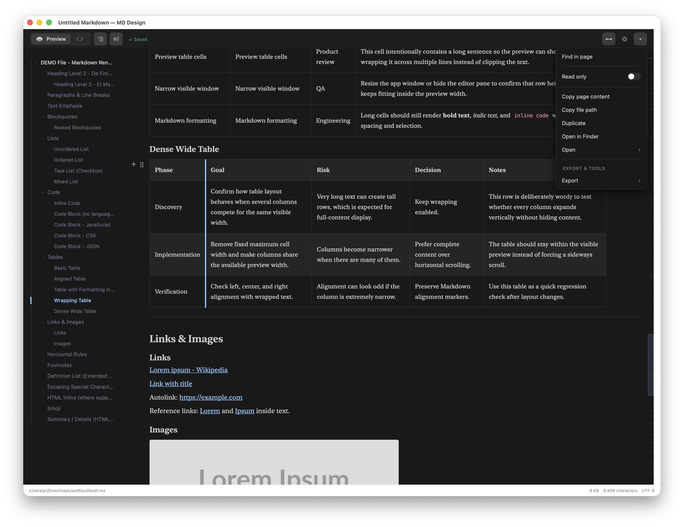
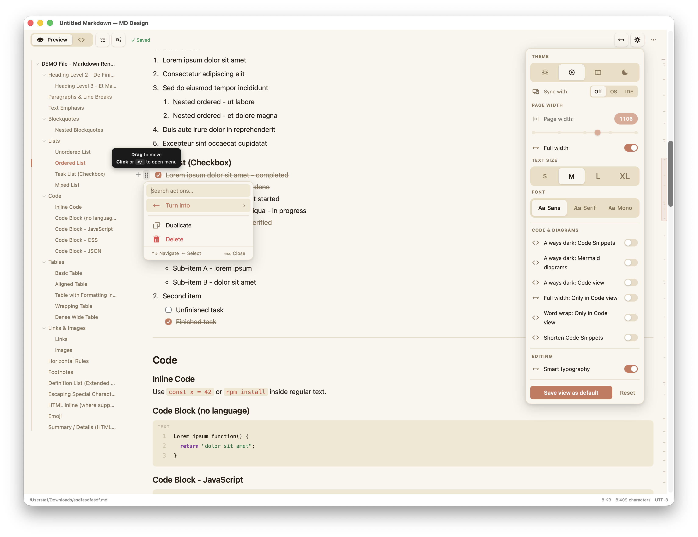
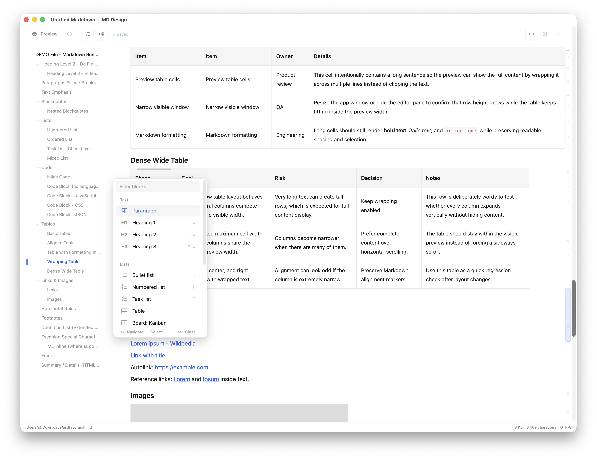

# Edit MD for Mac

A minimal native macOS Markdown viewer and editor for offline local files. No Electron, no server, no network requirement.

Current version is stored in `VERSION`.







## Можливості

### Файли

- Відкриває файли `.md`, `.markdown`, `.mdown`, `.mkd` і `.txt`.
- Виявляє зовнішні зміни. Якщо є незбережені правки, показує порівняння версій і дає застосувати версію з диска або залишити свої зміни.
- Якщо локальних правок немає, оновлює документ після змін на диску.

### Редактор

- Містить шпаргалку з Markdown і демонстраційний файл.
- Має два режими роботи з документом: Code і Preview.
- Дає форматувати заголовки, текст, посилання, списки й завдання через інтерфейс або символи Markdown.
- Дає створювати цитати, callout-блоки, згортані секції й таблиці через інтерфейс або символи Markdown. У таблицях можна додавати рядки та стовпці й змінювати їхню ширину.
- Підтримує зображення, блоки коду, діаграми Mermaid, дошки Kanban, табличні дошки й білі дошки.
- Має пошук у документі, зміст за заголовками та карту його структури.
- Дає переглядати файл у режимі лише читання.

### Вигляд та експорт

- Має теми light, dark і system.
- Дає змінювати шрифт, розмір тексту й ширину сторінки.
- Має перенесення довгих рядків у Code, темне оформлення блоків коду й діаграм, скорочений показ довгих фрагментів коду та автоматичну типографіку.
- Експортує документ у HTML або PDF.

## Download And Install

For end users, download the latest `Edit MD for Mac-vX.Y.Z.dmg` or `Edit MD for Mac-vX.Y.Z.zip` from GitHub Releases.

For normal installation, open the `.dmg` and drag the app into `Applications`.

⚠️ `I'm not apple-sertified developer, so your macOS will block the installation until you give the permission in System Settings - Privacy & Security section` or `you can download the source of the app (from github) and ask your AI to pack the app for you`.

## Requirements For Building

- macOS 13 or newer
- Swift toolchain from Xcode or Apple Command Line Tools

End users do not need Xcode to run the packaged `.app`. They only need the final app bundle.

## Versioning

The project version is stored in `VERSION`.

Release files include the version in their names:

```text
Edit MD for Mac-vX.Y.Z.zip
Edit MD for Mac-vX.Y.Z.dmg
```

The current version is **2.1.19**. Packaging writes VERSION to both `CFBundleShortVersionString` and `CFBundleVersion` in the macOS app bundle.

## Build Commands

```bash
swift build -c release
```

Run the executable directly:

```bash
.build/release/EditMDForMac
```

Open a file from Terminal:

```bash
.build/release/EditMDForMac /path/to/notes.md
```

## Package As `.app`

```bash
chmod +x scripts/package_app.sh
./scripts/package_app.sh
```

The app bundle will be created here:

```text
dist/Edit MD for Mac-vX.Y.Z.app
```

The script also creates a Finder-friendly archive:

```text
dist/Edit MD for Mac-vX.Y.Z.zip
```

It also creates a drag-to-install disk image:

```text
dist/Edit MD for Mac-vX.Y.Z.dmg
```

For normal installation, open the `.dmg` and drag the app into `Applications`. For versioned releases, the app bundle name includes the version, for example `Edit MD for Mac-v2.1.19.app`.

## Unsigned Local Build

Use this for personal/offline use on your own Mac:

```bash
./scripts/package_app.sh
open "dist/Edit MD for Mac-vX.Y.Z.app"
```

This creates a local ad-hoc signed app bundle, which keeps macOS resource validation happy but is still not Developer ID notarized.

If macOS warns because the app is not from an identified developer, allow it manually in **System Settings &gt; Privacy & Security** or right-click the app, choose `Open`, then confirm. This is expected for local builds and is not an app bug.

## Contributing

Contributions are welcome. See `CONTRIBUTING.md`.

## License

MIT License. See `LICENSE`. Third-party components are listed in [`THIRD_PARTY_NOTICES.md`](THIRD_PARTY_NOTICES.md).
